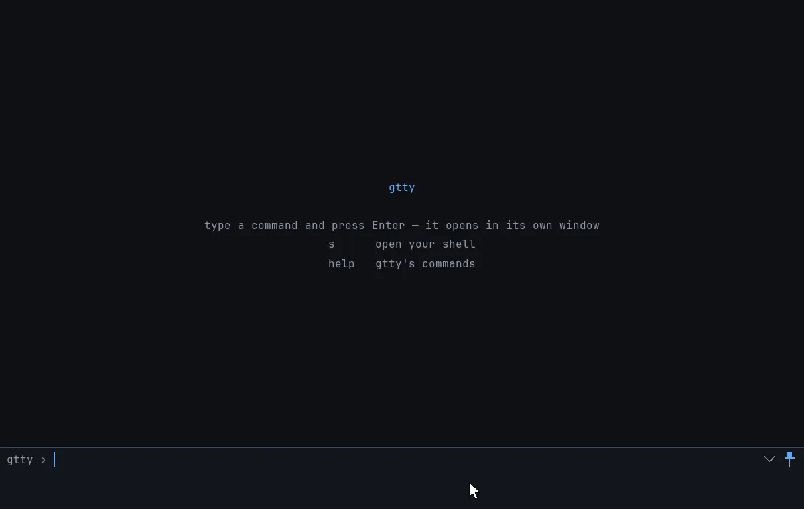
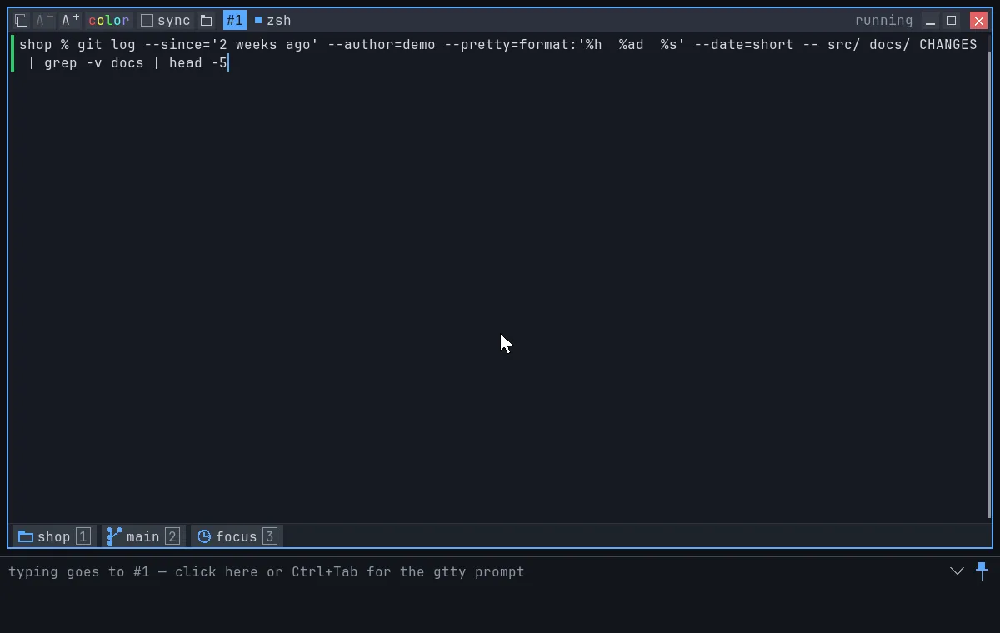
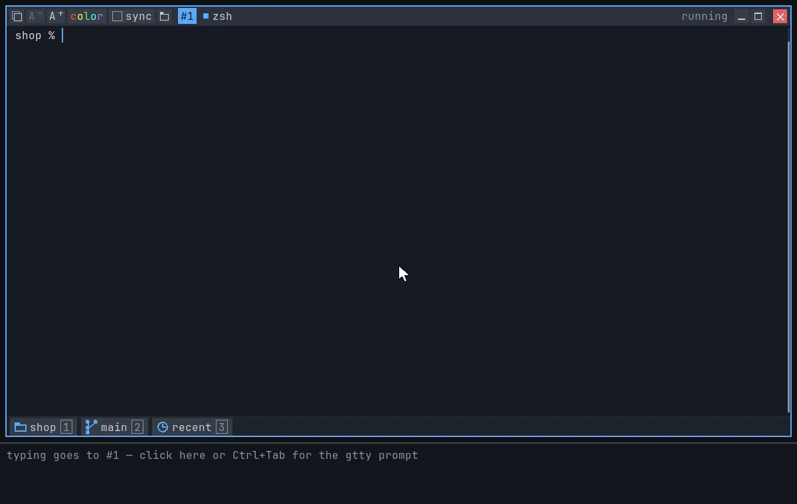
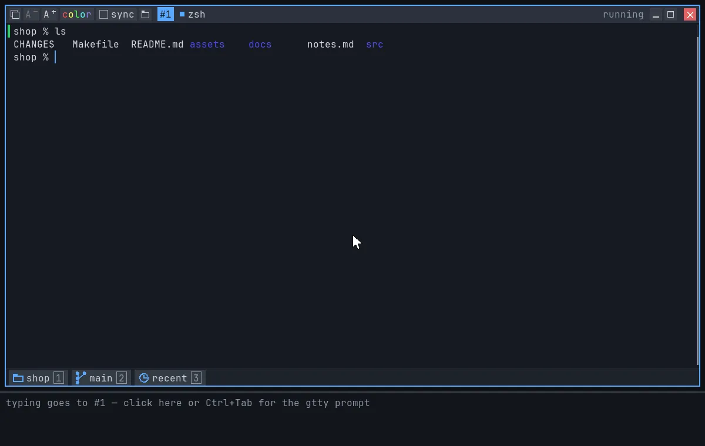
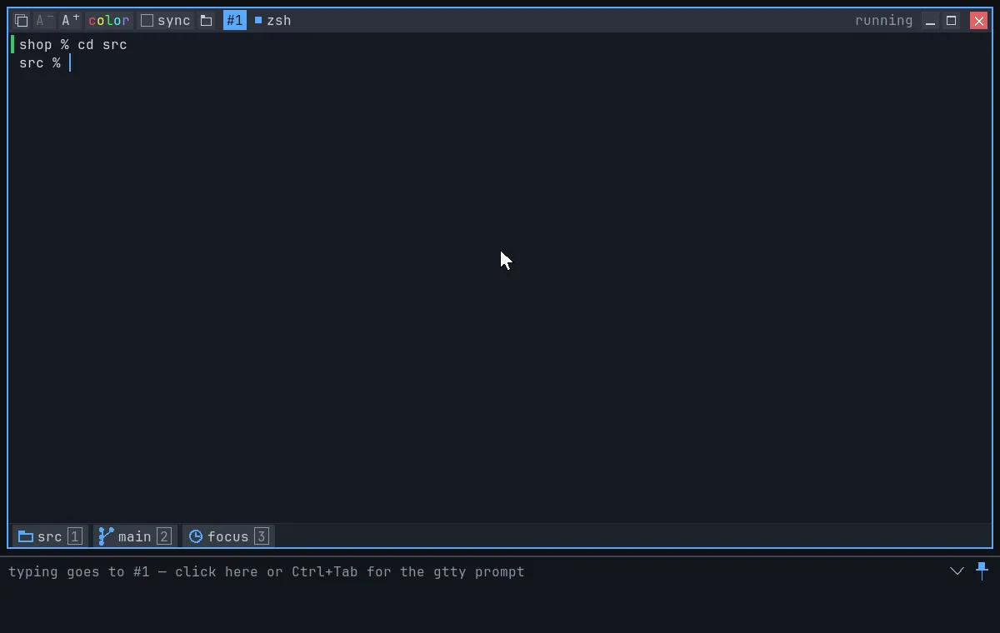
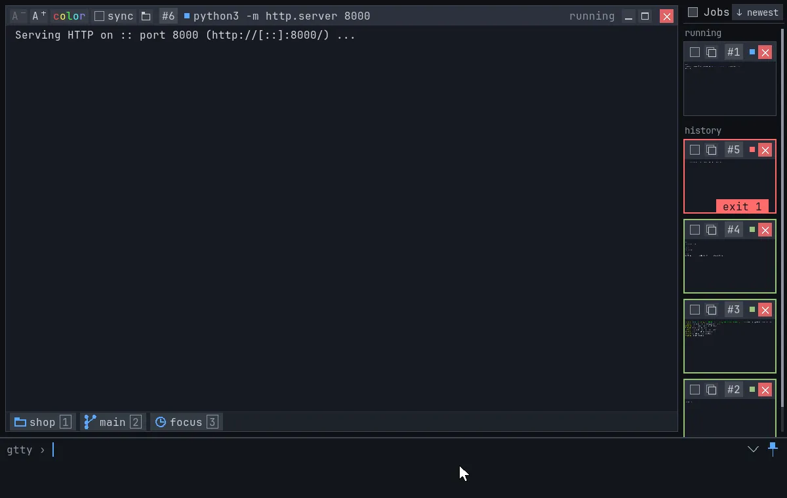
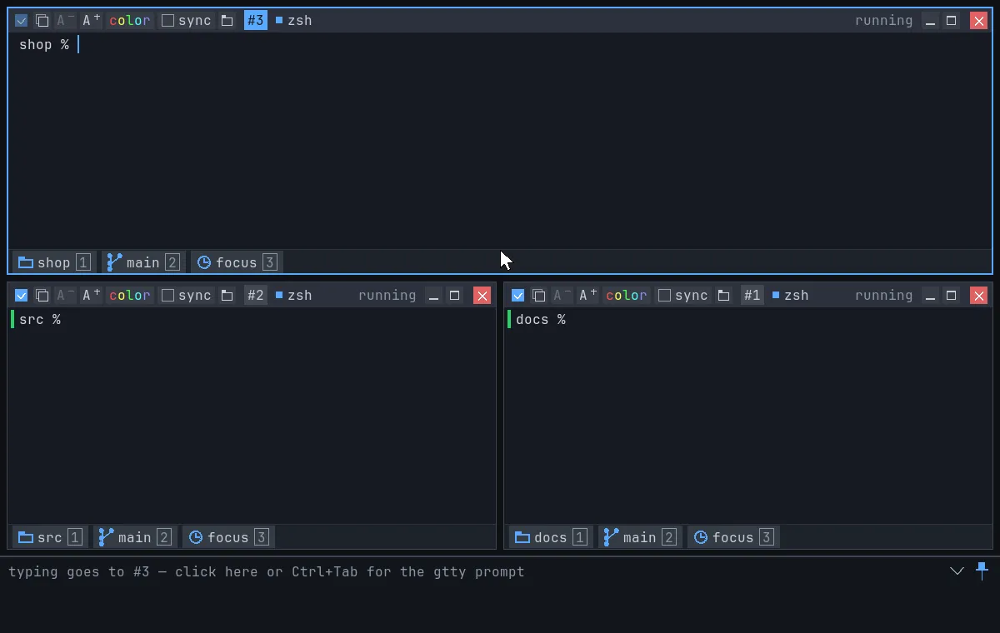

# gtty — True Graphic Virtual Terminal

A multi-window terminal: all your shells and commands on one screen, side
by side or one click away.

## Install

<!-- TODO: link the downloads once releases are published (codeberg.org/gttyterm/gtty, not created yet). -->

- **macOS** (Apple Silicon, 13+): download `gtty-<version>-macos.dmg` from
  the releases page *(TODO: link)* and drag gtty to Applications.
- **Linux** (x86_64): download `gtty-<version>-linux-x86_64.tar.gz` *(TODO:
  link)*, then `tar xzf gtty-*-linux-x86_64.tar.gz && sudo ./gtty-*/install.sh`
  (or `PREFIX=~/.local ./gtty-*/install.sh` for just you). `.deb` and
  `.rpm` packages are built too *(TODO: link)*.
- **Package managers:** *TODO* (no Homebrew tap or distro package yet).
- **From source:** see [HACKING.md](HACKING.md) (Zig 0.16 + SDL3).

## Features

### Edit long commands like text

A long command is text you can work on with the mouse, even when it
wraps over several rows: click to put the cursor anywhere, double-click a
word and type over it, drag to select and delete. From the keyboard,
⌥/Ctrl + arrows jump words and Shift selects (zsh and bash).

### Copy just the last output

One click on the copy button takes the last command's output: no prompt,
no command line, nothing from before. Your last copies wait under
**Paste ▸** in the right-click menu.

### Open files and change folders from the output

The names in your `ls` output work like icons in Finder on a Mac or in
the GNOME / KDE file manager. Hover a name and it gets an outline:

- **Double-click** opens a file in its app, or `cd`s into a folder (and
  lists it).
- **Right-click** a file to open it with its app (or pick another one),
  a folder to `cd` into it or show it in Finder / Files, and either for
  Rename, Copy, Cut, Paste, Move to Trash and Delete (with the usual
  shortcuts).
- **Drag** a file into another app, or drop files on a window to copy
  them into its folder.
- **History ▸** in the right-click menu `cd`s back to the folders you left.

### Recent: the folders you actually work in

The **recent** chip at the bottom of every window lists the folders you
did real work in lately (ran a build, git, an editor, a script), most
used first. Just looking around doesn't count: `cd`, `ls`, `pwd` and the
like leave no trace, so the list stays short and useful. Click it (or
⌘3), type a few letters, press Enter, and you're there. Shared by every
gtty window, kept between sessions.

### Chips: folder and git branch

The **folder** chip shows where the window's shell is: click it for any
folder above, or right-click to copy its path or open it in Finder /
Files. The **git** chip shows the branch: hover to see it in full, expand
it to filter the branches and switch with Enter.

### Many windows, one screen

Open as many shells and commands as you like. As many windows as fit sit
side by side; the rest wait in the grid on the right, one click away. A
window turns green when its command worked, red with the exit code when it
didn't.

### Type into several terminals at once

Tick **sync** on one window and everything you type there is typed into
every other window on screen as well: the same command on several
machines or folders at once.

### And also

- Readable colors on any theme: unreadable colors are lightened, and
  colors can be turned off per window.
- Emoji and wide characters (CJK) drawn in full; copy gives back exactly
  what was printed.
- Text reflows when you resize.
- Paste history and folder history (`cd` back) in the right-click menu.

More in the [user guide](docs/guide.md).

## What it doesn't do

- No account, no login, no telemetry.
- Your shell stays your shell: bash, zsh or fish, with your own config.
- Programs get a real terminal: ssh, git, build tools and REPLs work as
  usual. Full-screen programs (vim, htop, tmux) aren't fully supported
  yet.

## Source & license

Source and issues: codeberg.org/gttyterm/gtty *(TODO: the repository
doesn't exist yet)*.

Copyright 2026 Sagi Forbes Nagar. gtty is free software, licensed under the
GNU General Public License v3.0 or later — see [LICENSE](LICENSE).
Third-party components: [THIRD_PARTY.md](THIRD_PARTY.md). Contributing:
[CONTRIBUTING.md](CONTRIBUTING.md).

## About

gtty is designed and maintained by Sagi Forbes Nagar. The concept, UX and
architecture are my own; much of the code was written with AI assistance
(Claude) and reviewed, tested and shaped by me.
