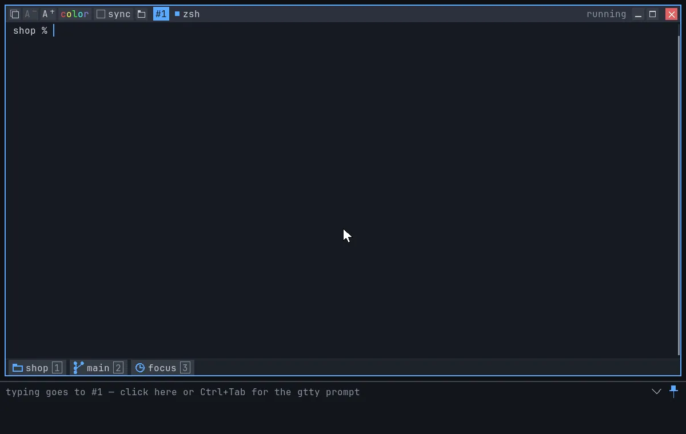
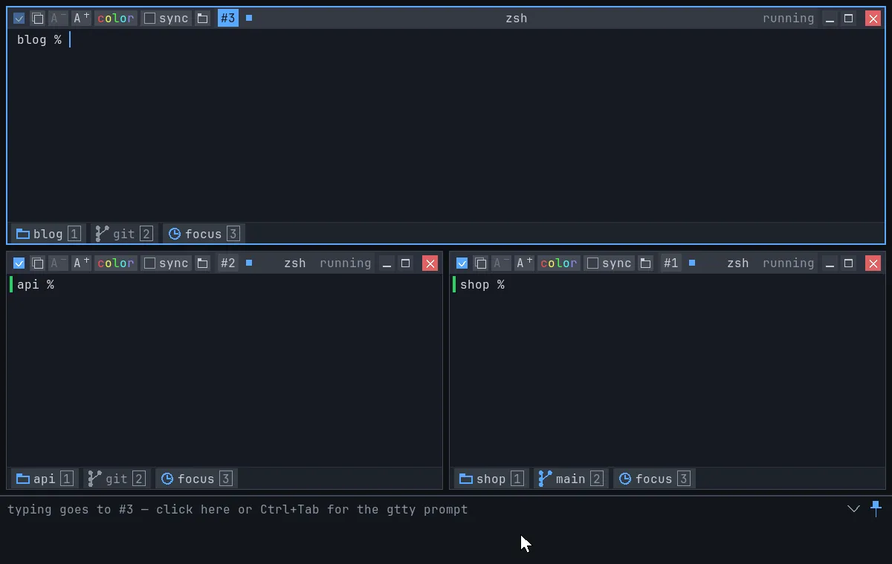

# gtty — True Graphic Virtual Terminal

[](https://github.com/gttyterm/gtty/releases/latest)
[](https://github.com/gttyterm/gtty/releases)
[](https://scorecard.dev/viewer/?uri=github.com/gttyterm/gtty)

A multi-window terminal: all your shells and commands on one screen, side
by side or one click away.


## Install

### macOS

Apple Silicon, macOS 13 or later. Download the latest stable release and
open it:

```sh
curl -fLO https://github.com/gttyterm/gtty/releases/latest/download/gtty-macos.dmg && open gtty-macos.dmg
```

1. In the window that opens, drag the **gtty** icon onto the
   **Applications** folder.
2. Eject the disk image (the ⏏ next to "gtty" in Finder's sidebar). You
   can delete `gtty-macos.dmg`.
3. Open gtty from Applications (or Spotlight: ⌘Space, type `gtty`). The
   first time, macOS may ask whether to open an app downloaded from the
   internet: click **Open**. gtty is signed and notarized by Apple.
4. If macOS still won't open it, go to **System Settings → Privacy &
   Security**, scroll down to the message about gtty and click **Open
   Anyway**.

To update, do the same again and let Finder replace the old copy.

### Linux

x86_64, glibc 2.31 or later. The latest stable release in one line.

Debian / Ubuntu:

```sh
curl -fLO https://github.com/gttyterm/gtty/releases/latest/download/gtty_amd64.deb && sudo apt install ./gtty_amd64.deb
```

Fedora / RHEL (older systems: `yum` instead of `dnf`):

```sh
sudo dnf install https://github.com/gttyterm/gtty/releases/latest/download/gtty.x86_64.rpm
```

openSUSE:

```sh
sudo zypper install https://github.com/gttyterm/gtty/releases/latest/download/gtty.x86_64.rpm
```

Any other rpm-based distro:

```sh
sudo rpm -U https://github.com/gttyterm/gtty/releases/latest/download/gtty.x86_64.rpm
```

Run the same line again to update.

### Other ways

Or download from the **[latest release](https://github.com/gttyterm/gtty/releases/latest)**
(each release lists its files and a `SHA256SUMS`):

- **macOS** (Apple Silicon, 13+): `gtty-<version>-macos.dmg`; open it and
  drag gtty to Applications.
- **Debian / Ubuntu** (x86_64): `gtty_<version>_amd64.deb`, then
  `sudo apt install ./gtty_*_amd64.deb`
- **Fedora / RHEL / openSUSE** (x86_64): `gtty-<version>-1.x86_64.rpm`, then
  `sudo dnf install ./gtty-*.x86_64.rpm` (openSUSE: `sudo zypper install …`)
- **Other Linux:** `gtty-<version>-linux-x86_64.tar.gz`, then `./install.sh`
  inside it.
- **From source:** see [HACKING.md](HACKING.md) (Zig 0.16 + SDL3).

To check a download: `shasum -a 256 -c SHA256SUMS --ignore-missing`
(Linux: `sha256sum -c SHA256SUMS --ignore-missing`).

## Features

### Edit long commands like text


A long command is text you can work on with the mouse, even when it
wraps over several rows: click to put the cursor anywhere, double-click a
word and type over it, drag to select and delete. From the keyboard,
⌥/Ctrl + arrows jump words and Shift selects (zsh and bash).

### Copy just the last output


One click on the copy button takes the last command's output: no prompt,
no command line, nothing from before. Your last copies wait under
**Paste ▸** in the right-click menu.

### Open files and change folders from the output


The names in your `ls` output work like icons in Finder on a Mac or in
the GNOME / KDE file manager. Hover a name and it gets an outline:

- **Double-click** opens a file in its app, or `cd`s into a folder (and
  lists it).
- **Right-click** a file to open it with its app (or pick another one),
  a folder to `cd` into it or show it in Finder / Files, and either for
  Rename, Copy, Cut, Paste, Move to Trash and Delete (with the usual
  shortcuts).
- **Drag** a file into another app, or drop files on a window to copy
  them into its folder.
- **History ▸** in the right-click menu `cd`s back to the folders you left.

### Focus: the folders you actually work in



The **focus** chip at the bottom of every window lists the folders you
did real work in lately (ran a build, git, an editor, a script): the
last seven at most, the newest at the bottom, right above the chip. Just looking around doesn't count: `cd`, `ls`, `pwd` and the
like leave no trace, so the list stays short and useful. Click it (or
⌘3), type a few letters, press Enter, and you're there. Shared by every
gtty window, kept between sessions.

### Sessions: save your screen, bring it back



**Session ▸ Take Snapshot** saves the shells on your screen: each one's
folder, where it sat, and for an ssh window the connection and the
folder on the other side. Later, pick the session from the **session**
chip (or ⌘4, or the Session menu) and they're all back at once: the
same shells in the same folders, side by side as before; an ssh window
connects again (a password is still yours to type) and goes back to its
folder. **Session Manager…** shows each saved
session as a picture of its screen. Sessions are shared by every gtty
on the machine.

### Chips: folder and git branch


The **folder** chip shows where the window's shell is: click it for any
folder above, or right-click to copy its path or open it in Finder /
Files. The **git** chip shows the branch: hover to see it in full, expand
it to filter the branches and switch with Enter.

### Many windows, one screen


Open as many shells and commands as you like. As many windows as fit sit
side by side; the rest wait in the grid on the right, one click away. A
window turns green when its command worked, red with the exit code when it
didn't.

### Type into several terminals at once


Tick **sync** on one window and everything you type there is typed into
every other window on screen as well: the same command on several
machines or folders at once.

### And also

- Readable colors on any theme: unreadable colors are lightened, and
  colors can be turned off per window.
- Emoji and wide characters (CJK) drawn in full; copy gives back exactly
  what was printed.
- Text reflows when you resize.
- Paste history and folder history (`cd` back) in the right-click menu.

More in the [user guide](docs/guide.md).

## What it doesn't do

- No account, no login, no telemetry.
- Your shell stays your shell: bash, zsh or fish, with your own config.
- Programs get a real terminal: ssh, git, build tools and REPLs work as
  usual. Full-screen programs (vim, htop, tmux) aren't fully supported
  yet.

## Source & license

Source and issues: codeberg.org/gttyterm/gtty *(TODO: the repository
doesn't exist yet)*.

Copyright 2026 Sagi Forbes Nagar. gtty is free software, licensed under the
GNU General Public License v3.0 or later — see [LICENSE](LICENSE).
Third-party components: [THIRD_PARTY.md](THIRD_PARTY.md). Contributing:
[CONTRIBUTING.md](CONTRIBUTING.md).

## About

gtty is designed and maintained by Sagi Forbes Nagar. The concept, UX and
architecture are my own; much of the code was written with AI assistance
(Claude) and reviewed, tested and shaped by me.
